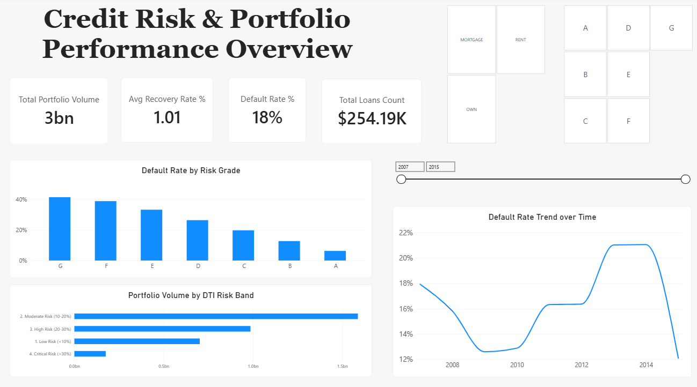
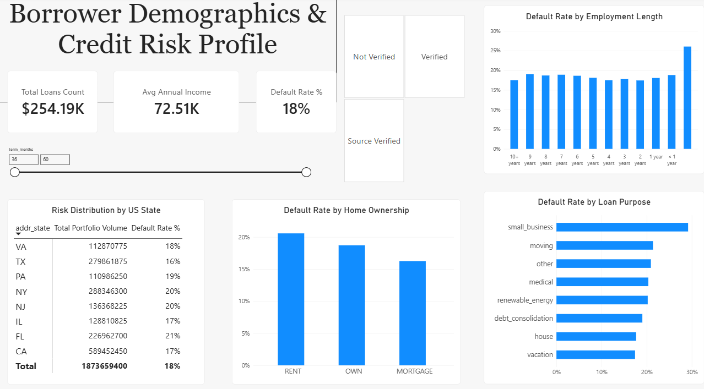
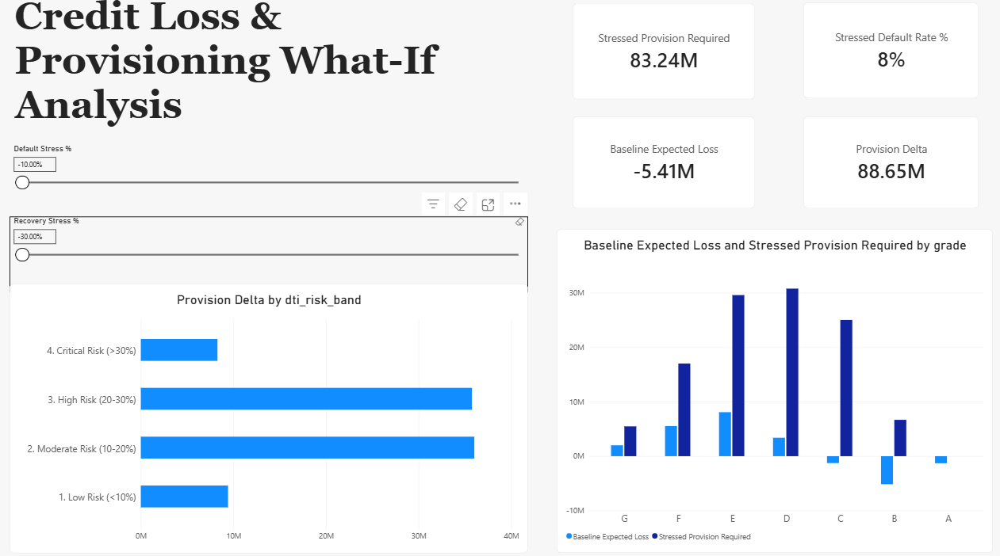

# Retail Credit Risk Management & Provision What-If Simulator

## Executive Summary & Project Goal

This project analyzes a consumer loan portfolio from **2007–2015**. Its objective is to identify key trends and relationships regarding:
* **Portfolio default rates** and underlying credit risk drivers
* **Borrower risk profiles** 
* **Collection effectiveness** and post-default capital recovery
* **Profitability & margin sustainability** across credit rating tiers

**Main Goal:** Build an interactive Business Intelligence solution and a **stress-testing simulator** that enable senior management and the credit risk team to quickly derive business insights and estimate capital reserve requirements under adverse economic scenarios.

---

## Main Clues & Recommendations

### Main Clues
1. **DTI as a Primary Risk Predictor:** Statistical testing confirms a highly significant difference ($p < 0.001$) in Debt-to-Income ratios between performing and defaulted borrowers. Higher DTI directly correlates with default spikes.
2. **The High-Risk Pricing Paradox (Adverse Selection):** 
   * **Grades A–B:** Low interest rates (~7%–11%) paired with low default rates (~6%–13%) generate stable, low-provision cash flows.
   * **Grades E–G:** Elevated interest rates (~18%–25%+) **do not compensate** for default rates exceeding 30%–40% combined with low recovery rates (~12%–15%).
   * **Economic Reality:** A single default in Grade G wipes out the interest yield of ~4 fully paying loans in the same tier. High interest rates trigger adverse selection (attracting cash-strapped borrowers with limited refinancing options).
3. **Income vs. DTI Illusion:** High annual income alone does not protect against default if the borrower carries an excessively high DTI ratio.

### Recommendations
1. **Underwriting Policy & DTI Hard Caps:** Enforce an automated hard cutoff at **DTI > 25%** for credit rating grades below C.
2. **Risk Appetite Adjustment on High-Risk Tiers:** Cease or heavily restrict uncollateralized origination in Grades F and G, or mandate co-signers/collateral guarantees.
3. **Shift to Upfront Origination Fees:** Replace reliance on nominal high interest rates in high-risk categories with upfront Origination Fees collected at disbursement, locking in capital protection immediately.
4. **Macro Scenario Capital Buffer:** Utilize the What-If Provision Simulator during annual ICAAP/CCAR stress testing to lock in extra capital reserves (Provision Delta) prior to projected economic downturns.

---

## Statistical Significance & Risk Analysis

### 1. Statistical Significance Testing (DTI & Income)
To compare borrowers who are **Fully Paid** vs. **Charged Off** (defaulted), two-sample hypothesis testing was performed (*Welch’s t-test / Mann-Whitney U test* due to heavily skewed distributions).

#### A. Debt-to-Income (DTI) Ratio
* **Null Hypothesis ($H_0$):** Mean DTI ratio is equal for both performing (Fully Paid) and non-performing (Charged Off) borrowers.
* **Alternative Hypothesis ($H_1$):** Non-performing borrowers have a statistically significantly higher DTI ratio.
* **Results & Findings:** Statistically significant difference ($p < 0.001$). Defaulted borrowers exhibit a substantially higher average debt-service burden relative to their income.
* **Business Takeaway:** The DTI ratio serves as a highly effective risk predictor. Tightening credit policy (enforcing a strict cap at DTI > 25%) allows the institution to reject a large share of potential default risks while preserving healthy portfolio volume.

#### B. Annual Income
* **Null Hypothesis ($H_0$):** Income level has no effect on the likelihood of default.
* **Alternative Hypothesis ($H_1$):** Defaulted borrowers earn significantly lower annual incomes.
* **Results & Findings:** The difference in mean income is statistically significant ($p < 0.001$). However, because annual income exhibits a heavily right-skewed distribution driven by high-income outliers, **median income** provides a more reliable baseline.
* **Business Takeaway:** Higher income lowers default probability, but evaluating income without DTI context can be misleading—high earners carrying excessive debt burdens still generate high default rates.

---

### 2. Risk vs. Margin Analysis (Risk-Adjusted Return / RAROC)

**Business Question:** Does the higher interest rate (`int_rate`) charged to riskier rating tiers (Grades E, F, G) sufficiently compensate the lender for losses stemming from elevated default rates (`Charged Off`)?

#### Portfolio Breakdown by Credit Risk Grade

| Credit Grade | Interest Rate (`int_rate`) | Default Rate | Recovery Rate (Avg) | Margin & Performance Outcome |
| :--- | :--- | :--- | :--- | :--- |
| **Low-Risk (A, B)** | Low (~7% – 11%) | Low (~6% – 13%) | N/A (Minimal Loss) | Low unit margin balanced by strong performance stability and minimal provisioning costs ($LGD/EL$). |
| **High-Risk (E, F, G)** | Very High (~18% – 25%+) | Very High (>30% – 40%) | Low (~12% – 15%) | **Negative Net Margin.** Interest income fails to cover Expected Loss ($EL$). |

#### Core Economic Conclusion
Higher interest rates on Grades E, F, and G **DO NOT** fully offset the underlying credit losses.
* **Adverse Selection Effect:** Charging extremely high interest rates (e.g., 24%) disproportionately attracts cash-strapped borrowers with severe credit risk, while driving creditworthy borrowers elsewhere.
* **Net Loss Math:** When a Grade G borrower fully repays, the bank earns a **+22%** interest yield. However, when a borrower defaults (Charged Off), the bank loses **100% of the principal** minus marginal collections recovery (a net loss of ~85% on total exposure).
* **Portfolio Economics:** A single default in Grade G wipes out the interest margins generated by nearly 4 fully performing loans in the same grade. At default rates reaching 35–40%, interest income fails to cover the Expected Loss ($EL$).

---

## System Architecture & Workflow

1. **ETL (Python):** Cleanses, standardizes, and transforms raw peer-to-peer lending data, handling missing values, right-skewed outliers, and numerical type conversions.
2. **Feature Engineering & Target Encoding (Python):** Isolates completed loans to prevent target leakage, defines binary credit risk buckets (Performing vs. Defaulted), and engineers continuous chronological variables for downstream risk modeling.
3. **Analytics & Transformation (DAX):** Leverages DAX formulas. Drives exploratory data analysis to validate business hypotheses and confirms the adverse selection effect in high-risk tiers.
4. **Business Intelligence & Forecasting (Power BI):** Visualizes credit risk KPIs, demographic distributions, and deploys an interactive What-If stress-testing simulator to forecast capital reserve requirements under macroeconomic stress scenarios.

## Python

### 1. Feature Selection & Target Encoding
To accurately calculate default rates, the dataset was filtered to include only completed loan lifecycles. In-flight loans were excluded to prevent target leakage. A binary risk flag (`is_default`) was engineered to streamline DAX calculations in Power BI.

```python
# 1. Isolate completed loans to prevent target leakage
df_closed = df_sub[
    df_sub["loan_status"].isin(["Fully Paid", "Charged Off", "Default"])
].copy()

# 2. Engineer binary target variable (1 = Default, 0 = Performing)
df_closed["is_default"] = (
    df_closed["loan_status"].isin(["Charged Off", "Default"]).astype(int)
)
```
### 2. Change data type
Below are preview screenshots of the interactive Power BI dashboard.
```python
# Convert percentage strings to strict numeric formats
for col in ["int_rate", "revol_util"]:
    df_closed[col] = df_closed[col].astype(str).str.replace("%", "").str.strip()
    df_closed[col] = pd.to_numeric(df_closed[col], errors="coerce")

# Extract integer duration from text (e.g., "36 months" -> 36)
df_closed["term_months"] = df_closed["term"].str.extract(r"(\d+)").astype(float)

# Standardize employment length using a predefined dictionary map (emp_map)
# Example: "< 1 year" -> 0, "10+ years" -> 10
df_closed["emp_length_years"] = df_closed["emp_length"].astype(str).str.strip().map(emp_map)
```

## Dashboard & Visual Reports

### Page 1: Executive Portfolio Overview


---

### Page 2: Risk Profile & Demographics


---

### Page 3:  What-If / Provision Simulator 



## Tech Stack & Tools

* **Environment:** Jupyter Notebook, Visual Studio 
* **Data Processing & ETL:** Python (`pandas`, `numpy`) – Data cleaning, type casting, missing value imputation, and automated preprocessing.
* **Statistical Analysis:** Hypothesis testing for continuous risk drivers and statistical validation.
* **Architecture & Workflow Visualization:** Mermaid.js / UML – Flowcharts and architecture diagrams.
* **Data Visualization & Modeling:** Power BI – star schema, creating DAX metrics, dynamic What-If parameters, and interactive filtering.
